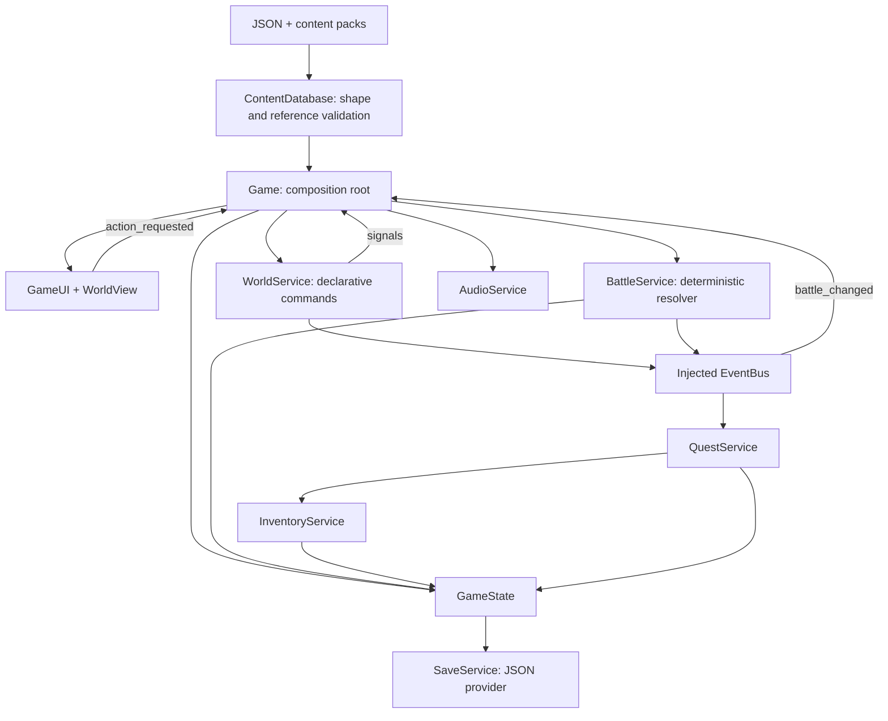
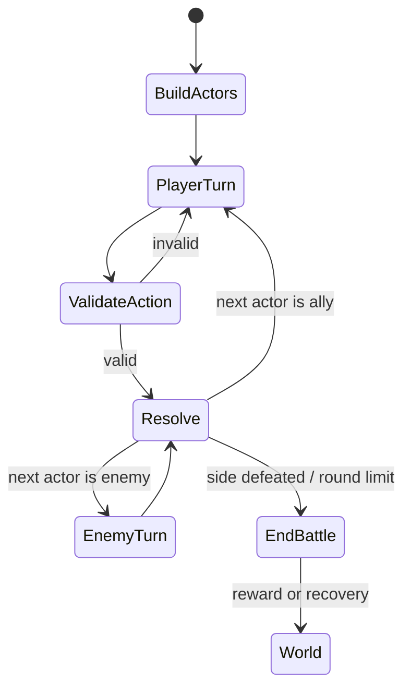

# Архитектура

## Решение

`scripts/core/game.gd` — точка сборки зависимостей и маршрутизатор экранов. Сервисы создаются один раз на сессию и передаются друг другу в конструкторы. Autoload/singleton не используются. Сервисы не знают о кнопках, дереве сцен или WebAssembly. UI читает состояние и отправляет намерения; сами изменения выполняют сервисы. Данные сессии — один JSON-совместимый словарь.

## Подсистемы

| Система / расположение | Зависимости и поток | Точки расширения / следующие улучшения | Производительность, проверка, частые ошибки |
|---|---|---|---|
| Контент — `scripts/core/content_database.gd`, `data/manifest.json` | Чтение JSON → ordered merge модов → структура → ссылки | Новые каталоги и команды; формальная JSON Schema и диагностические пути для всех вложенных полей | Один проход при запуске. Проверять отсутствующие ссылки и неверные типы. Не путать произвольные ID и пути ресурсов. |
| Состояние — `scripts/core/game_state.gd` | DB + EventBus; хранит партию, карту, прогресс, инвентарь | Компоненты оборудования/статусов, relationship state | Маленький словарь, копирование только для снимков. Проверять переход уровня и восстановление. Не сохранять Node/Resource в JSON. |
| Мир — `scripts/world/world_service.gd` | State + DB + Inventory + Bus; выбирает первую подходящую ветвь, исполняет команды | Новые карты/NPC — JSON; сложный путь движения и коллизии через замену WorldView | Здесь нет визуальной карты/навигационной сетки; движение ограничено прямоугольником террасы. Проверять закрытые пути и повторные взаимодействия. Специфичные story ID не добавлять в сервис. |
| Отображение мира — `scripts/world/world_view.gd` | Map definition + world config; сигнал положения и взаимодействия | AnimatedSprite2D/TileMapLayer, отдельный контроллер игрока, камера | Один redraw простого персонажа за кадр. Проверять край карты, движение и касания после закрытия меню. Не связывать пиксельные координаты с сохранением. |
| Бой — `scripts/battle/battle_service.gd` | DB + State + Inventory + Bus; start → очередь → проверка → расход → эффект → конец хода | Новые эффекты через выделяемый registry; статусы, buff/debuff, выбор AI, более 2 врагов потребует более гибкого battle layout | Чистый resolver без таймеров. Headless RNG seed делает воспроизведение точным. Проверять недействительные цели, отсутствие MP, пропуск павших, границы HP и round limit. Не расходовать ресурс до проверки цели. |
| Инвентарь — `scripts/inventory/inventory_service.gd` | State + DB + Bus; add/consume → inventory_changed | Экипировка, магазины, capacity/stack rules | O(1) по ID. Проверять отсутствие предмета и неизвестный ID. Не изменять количество напрямую из UI. |
| Квесты — `scripts/quests/quest_service.gd` | Bus + DB + State + Inventory; domain event → текущий шаг → одноразовая награда | Ветвящиеся, параллельные, ежедневные квесты; миграция изменённых quest IDs | Линейный проход активных квестов; позже индексировать по теме события. Проверять duplicate events и чужой encounter ID. Не применять награду до фиксации прогресса. |
| Сохранения — `scripts/save/save_service.gd` | State + DB + Bus; temp → backup → rename; load → migration → validate → replace state | Облачный адаптер, конфликт версий, экспорт/импорт файла, дополнительные миграции | На границах событий, не каждый кадр. Повреждённый основной файл восстанавливается из `.bak`. Слот 0 — auto, 1–3 — manual. Не сохранять середину боя как обычное world-состояние. |
| UI — `scripts/ui/game_ui.gd`, `skin.gd` | Читает сервисы; action_requested → Game | Разделить экраны в `.tscn`, полностью вынести локализацию, анимационные state machines | Экраны пересобираются при дискретных событиях, не каждый кадр. Это удобно для первого среза, но сложные экраны далее должны обновляться по компонентам. Проверять desktop/portrait/focus/длинные тексты. Не выполнять боевые формулы в виджетах. |
| Ввод — `scripts/input/input_setup.gd` | Godot InputMap → WorldView / UI | Пользовательские привязки, экраны раскладки контроллера | Нативные события и Input.get_vector. D-pad/стик/A настроены; физическое устройство пока не тестировалось. Проверять фокус, чтобы нажатие не прошло сквозь модальное окно. |
| Аудио — `scripts/audio/audio_service.gd` | Управляется Game; отдельные плееры музыки и обратной связи | Crossfade, слои адаптивной музыки, голос/пространственный звук, bus mixer | Короткие WAV; музыка стартует после пользовательского действия. Плееры освобождаются при выходе. Проверять mute/unmute и смену трека. Не запускать таймер AI внутри аудио. |
| Эффекты — `scripts/effects/ambient_particles.gd` | Фиксированный пул параметров из config | Weather presets, бюджет эффектов, shader glow | Частицы аналитически рассчитываются без создания Node на кадре. Нет настоящего bloom. Проверять overdraw на телефонах. Не добавлять мобильные post-processing эффекты без замеров. |
| Инструменты — `tools/content_editor.*`, `tests/test_runner.gd` | Те же DB/resolver; редактор проверяет в памяти до записи | Формы для каждого типа контента, визуальный graph editor, TileMap integration, save editor | Не экспортируются игроку. Проверять malformed JSON и ссылки. Редактирование модифицирует исходники, поэтому используйте Git. |

## Бой: контракт

`start(encounter_id, seed)` создаёт независимые боевые копии акторов. `can_use(skill_id)` учитывает изученные навыки, ману и резонанс. `act(skill_id, target_id)` возвращает false без побочных эффектов при неверной цели. `use_item` проверяет сторону, живую цель и наличие предмета. `ai_turn` применяет тот же resolver.

Расчёт урона: `(attack × power − defense × defense_factor) × variance`, затем множители слабости, критического удара и защиты. Минимальный урон ограничивается JSON. Защита заканчивается перед следующим ходом защищавшегося персонажа. Командная атака требует всех живых союзниц и установленного количества резонанса.

## Компромиссы

- ECS целиком не внедрён: для небольшого отряда полезнее независимые сервисы и data components. Большая ECS здесь увеличила бы сложность без доказанного выигрыша.
- Текущее рисованное окружение — одна текстура на карту, а не полноценный tileset. Замена world renderer не затрагивает бой/сохранения; координаты сохранены нормализованно.
- Загрузка ресурсов пока синхронная: текущие ассеты малы. Для больших фонов потребуется `ResourceLoader.load_threaded_request`, политика освобождения и атласы персонажей. Не заявляем наличие lazy/async streaming в этой версии.
- Не обещается «никогда не требовать переписывания»: границы модулей уменьшают стоимость изменений, но будущие требования могут потребовать миграции данных и изменения контрактов.
- Однопоточный Compatibility/WebGL2 выбран для браузерной совместимости. См. [официальную документацию Godot 4.5](https://docs.godotengine.org/en/4.5/tutorials/export/exporting_for_web.html). HTTP compression для `.wasm` на хостинге нужно настроить отдельно.
